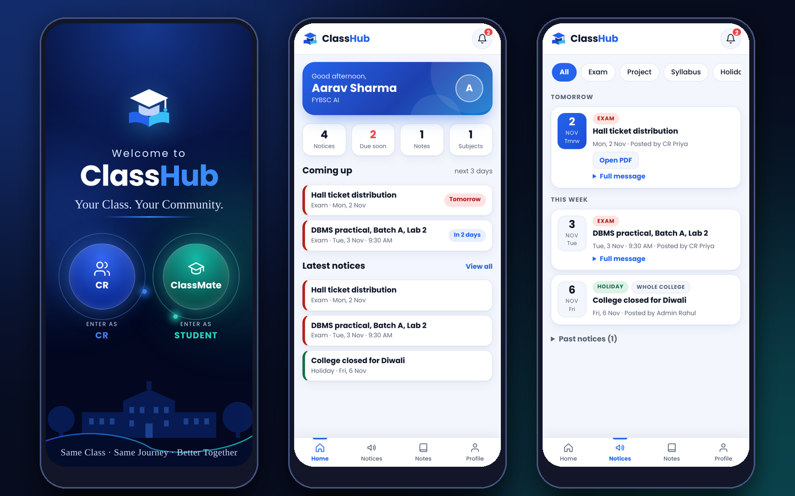

<div align="center">


# ClassHub

**Your Class. Your Community.**

A phone-first notice board for a college class. Notices, exam dates, project deadlines and notes in one trusted place, instead of getting lost in WhatsApp.

[](https://classhub-blush.vercel.app)


<br />



</div>

---

## The problem

In my class the CR shares every notice, date and note by hand on WhatsApp. Messages get buried, scanned PDFs are hard to find, and people miss deadlines.

**ClassHub gives the class one place for all of it.** The CR posts once, and every classmate sees it instantly on their phone, sorted by date, with a reminder before it is due.

## Features

| | |
|---|---|
| **Three doors** | A ClassMate (student) login, a CR login, and a hidden admin login. |
| **Six notice types** | Exam, Project, Syllabus, Holiday, Event and Announcement, each with its own colour. |
| **Photo and PDF notices** | The CR can take a photo, pick one from the gallery or attach a PDF. Photos are shrunk on the phone before upload. |
| **Paste-to-fill** | Paste a WhatsApp message and the app suggests the title, type, date and time. It understands "tomorrow", "kal", weekdays and dates like 5 Nov. |
| **Coming up** | The home screen shows what is due in the next 3 days, with a bell badge and a "due tomorrow" reminder. |
| **Notes library** | Subject-wise notes as a Google Drive link or a PDF. |
| **Admin panel** | Class stats, students with last-active time, make or remove a CR, remove an account, create classes, and post college-wide notices. |
| **Multi-class** | Every class has its own code and sees only its own notices. One admin can run many classes. |
| **Roll-number list** | The admin can allow only the roll numbers on the class list to sign up, and close sign ups completely. |
| **Live updates** | New notices appear without refreshing. |
| **Light and dark theme** | Installable on the phone home screen, built phone-first. |

## Who can do what

| | Student | CR | Admin |
|---|:-:|:-:|:-:|
| Read notices and notes | ✅ | ✅ | ✅ |
| Post and delete notices and notes in own class | | ✅ | ✅ |
| See the student list | | ✅ | ✅ |
| Make or remove a CR | | | ✅ |
| Create classes, post college-wide notices | | | ✅ |
| See every class | | | ✅ |

## How it works

```
Phone (HTML + CSS + JS)  ──►  Supabase  ──►  Postgres + Row Level Security
        hosted on Vercel         │
                                 ├─ Auth       roll number + 6-digit PIN
                                 ├─ Storage    private bucket for photos and PDFs
                                 └─ Realtime   live notice updates
```

| Part | Technology |
|---|---|
| App | Plain HTML, CSS and JavaScript. No framework, no build step. |
| Database, login, files | [Supabase](https://supabase.com): Postgres, Auth, Storage, Realtime |
| Hosting | [Vercel](https://vercel.com) |

### Security

- Students sign up with a **class code**, their **roll number** (format checked) and a **6-digit PIN**. No personal email is collected.
- Who can read or write what is enforced **inside the database** with Row Level Security, not in the app code. A student cannot post, and a CR cannot touch another class, even by calling the API directly.
- Notice photos and PDFs sit in a **private** storage bucket. They are downloaded with the member's own login and shown from a private in-browser address, so there is **no web link** to copy and forward.
- Roles are stored in the database and can only be changed by the admin.
- Only the public (publishable) Supabase key is used in the app. No secret keys are in this repository.
- Text from notices is always shown as plain text, so pasted HTML or scripts cannot run.

## Project files

| File | What it does |
|---|---|
| `index.html` | The whole interface: screens, styles and layout |
| `app.js` | App logic: login, notices, notes, admin, reminders |
| `parser.js` | Reads pasted messages and finds title, type, date and time |
| `config.js` | Supabase project URL and public key |
| `schema.sql` | Tables, security rules, storage bucket and helper functions |
| `manifest.webmanifest`, `icon-*.png`, `icon.svg` | Install-on-phone support and icons |

## Run your own copy

1. Create a free Supabase project and turn **off** "Confirm email" (Authentication, Providers, Email).
2. Run `schema.sql` in the Supabase SQL Editor. It creates the tables, security rules and storage.
3. Create your class: `insert into public.classes (name, code) values ('My Class', 'MY-CODE-26');`
4. Put your Supabase project URL and publishable key in `config.js`.
5. Deploy this folder on Vercel (framework preset: Other).
6. Sign up in the app with your class code, then make yourself admin:
   `update public.profiles set role = 'admin' where roll = 'YOUR-ROLL';`

## Roadmap

- [x] Notices with photos and PDFs
- [x] Notes library
- [x] CR and admin roles
- [x] Multi-class support
- [x] Roll-number allow list
- [ ] Push notifications when the app is closed
- [ ] Reading the text of notice photos and scanned PDFs automatically

## Author

Built by [@rajyadav-dev](https://github.com/rajyadav-dev), a first-year BSc AI student, with AI help.

If you are a classmate and something looks wrong, tell me and I will fix it.
